# 🎬 Movie Poster Shop

A cross-platform e-commerce app for movie posters, built with **React Native (Expo)** and **TypeScript**. Movies and posters come live from **TMDB**, prices can be shown in six currencies using live exchange rates from **Frankfurter**, and the basket is managed with **Redux Toolkit**. The app runs on iOS, Android and in the browser, with a responsive layout for both mobile and desktop.

> School project – Mobile Application Development, Folkuniversitetet Göteborg.

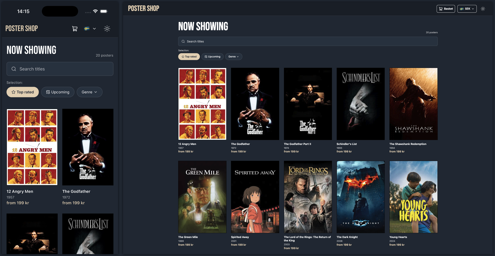

---

## Features

### Shop

- Browse **Top rated** movies (default), **Upcoming** movies, or 12 **genres** – each list is fetched from TMDB
- **Search** titles on TMDB with a debounced search field (one request after you stop typing)
- Responsive grid: **2 columns** on mobile, **3** on tablet, **5** on desktop
- Only movies **with a poster** are shown – it's a poster shop
- Loading, error ("Try again") and empty states

### Movie details

- Real poster, title, release year and director (from TMDB credits)
- Choose **size** (30×50 / 50×70) and **frame** (None / Black / Silver)
- Live **frame preview** on the poster and a **live price** that updates with every choice
- "Add to basket" is disabled for movies without a poster

### Basket

- Add posters from the details screen – the same size and frame are merged into one row
- Change **quantity** with a stepper, **remove** single rows or **clear** the whole basket
- Item count badge in the header, visible on every screen
- Total price, and a checkout button that clears the basket and returns to the shop

### Feedback

- **Toast notifications** – a short confirmation slides up when a poster is added to the basket and after checkout
- The toast hides itself after 2.5 seconds and is shown on top of every screen

### Currency

- Prices in **SEK, EUR, USD, GBP, NOK or DKK** via a dropdown menu with flags
- **Live exchange rates** from the Frankfurter API, fetched on app start
- Hardcoded fallback rates – the app keeps working if the currency API is unavailable

### Theme

- **Dark and light** theme, toggled from the header

### Attribution

- Footer below the shop grid credits TMDB and Frankfurter, with links to both

---

## Screenshots

| Shop – mobile (dark)                                       | Shop – mobile (light)                                        | Details – mobile                                       |
| ---------------------------------------------------------- | ------------------------------------------------------------ | ------------------------------------------------------ |
| 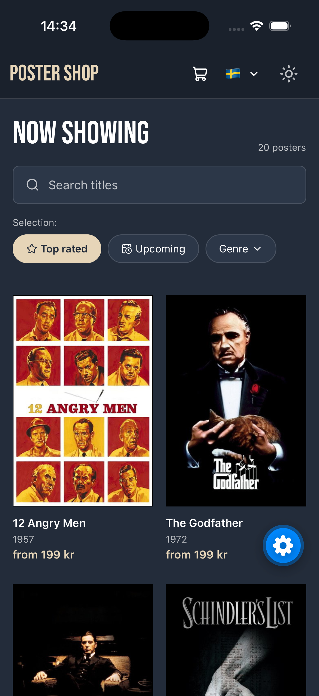 | 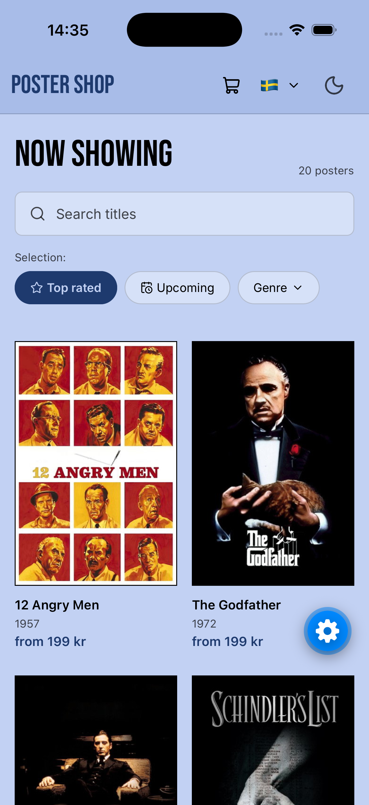 | 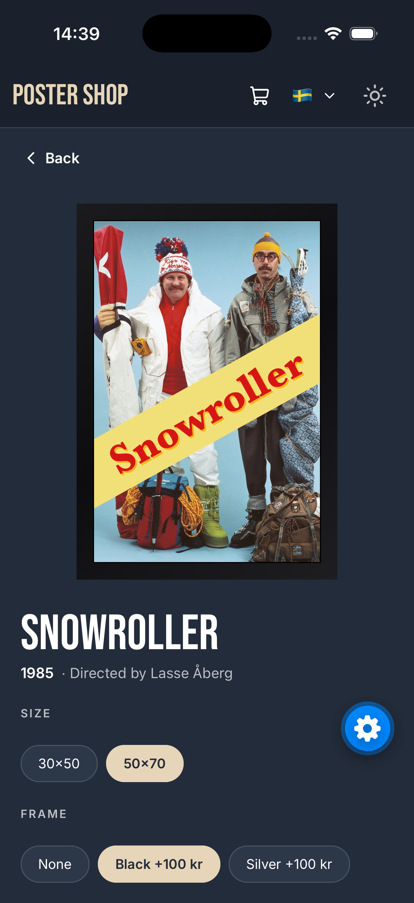 |

| Genre filter                                        | Search                                        | Basket – mobile                                      |
| --------------------------------------------------- | --------------------------------------------- | ---------------------------------------------------- |
| 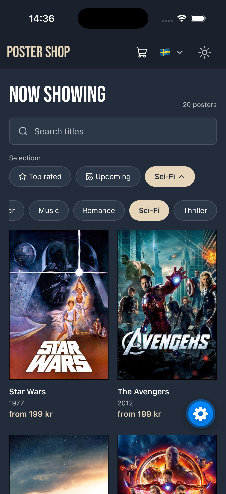 | 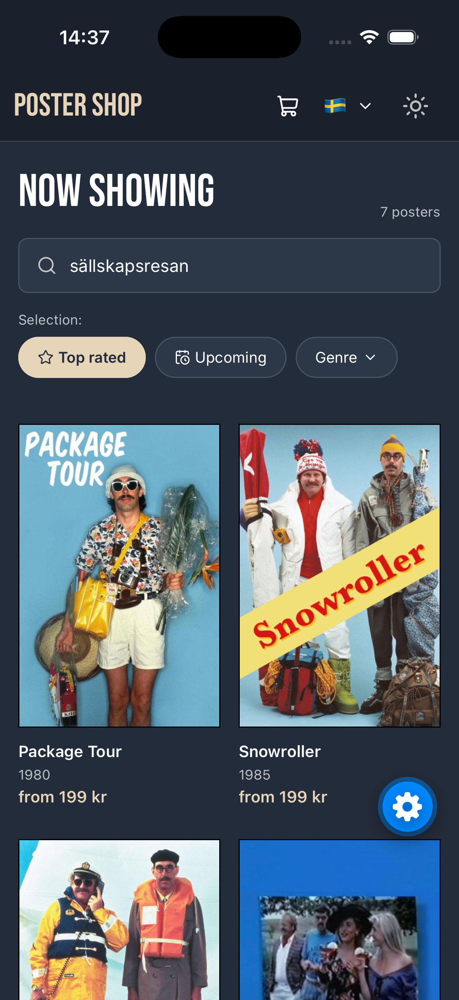 | 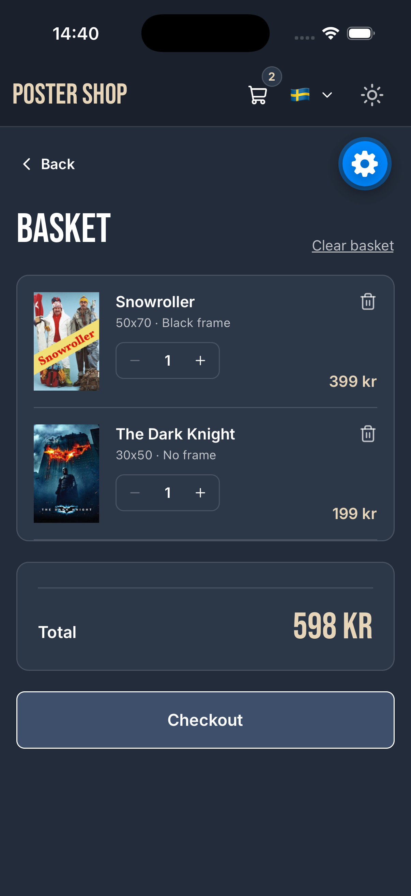 |

| Toast – added to basket                          | Toast – checkout                                       | Footer                                 |
| ------------------------------------------------ | ------------------------------------------------------ | -------------------------------------- |
| 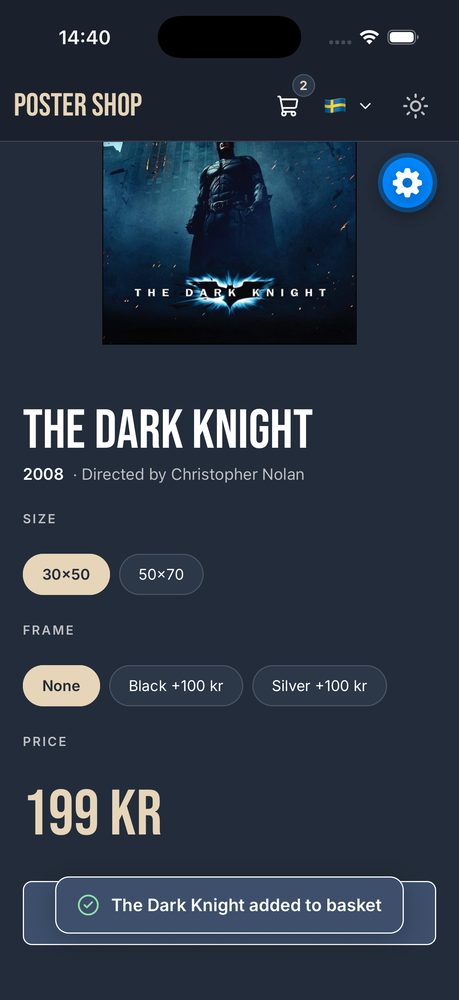 | 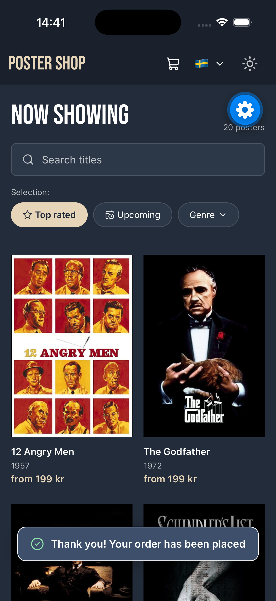 | 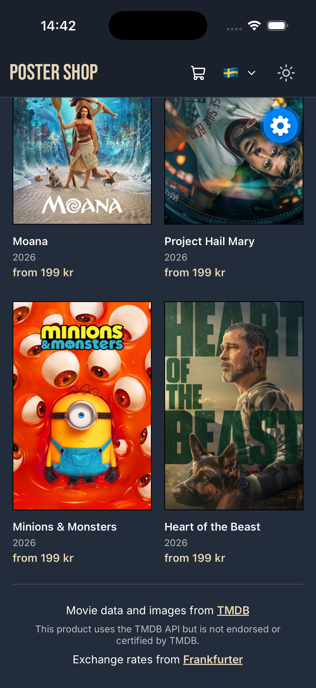 |

**Desktop**

<!-- Screenshot: shop grid with 5 columns -->

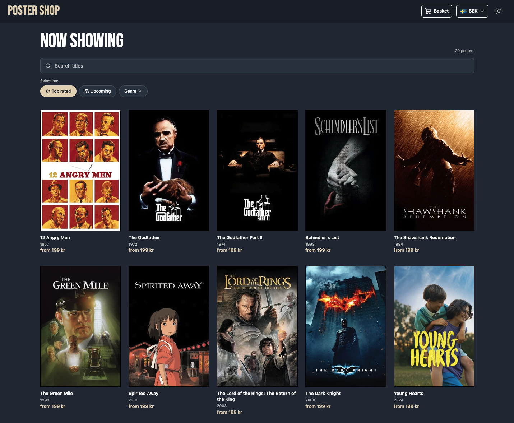

<!-- Screenshot: details screen on desktop with a black or silver frame -->

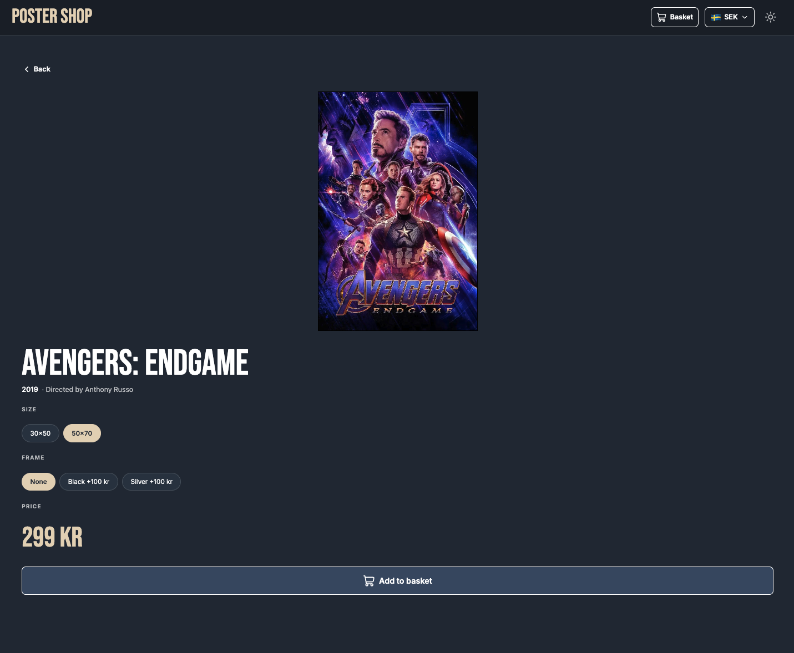

<!-- Screenshot: basket on desktop -->

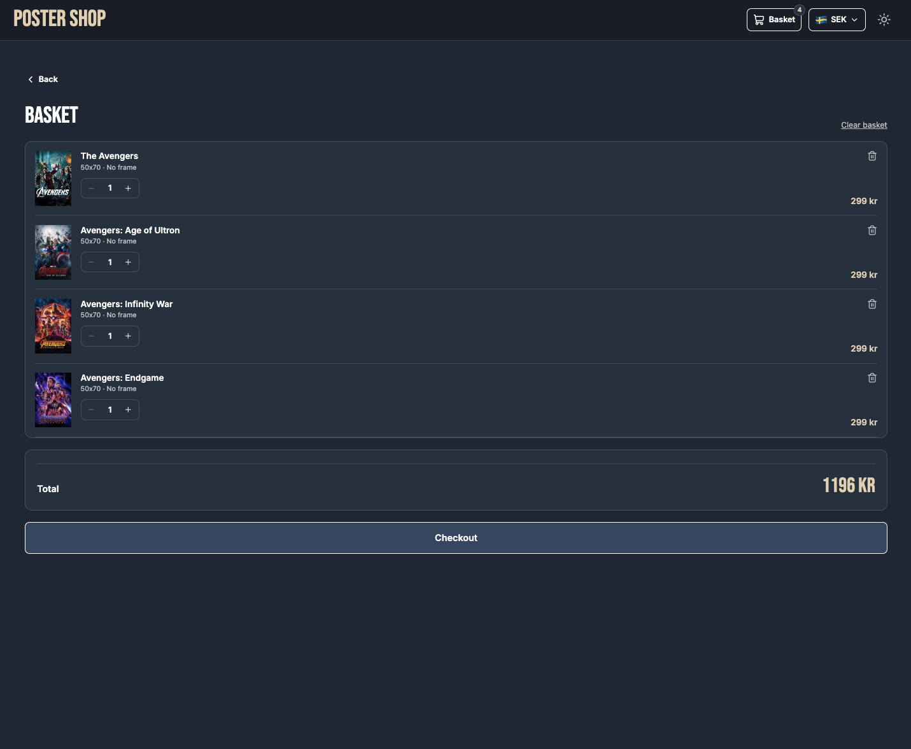

<!-- Screenshot: currency dropdown open -->

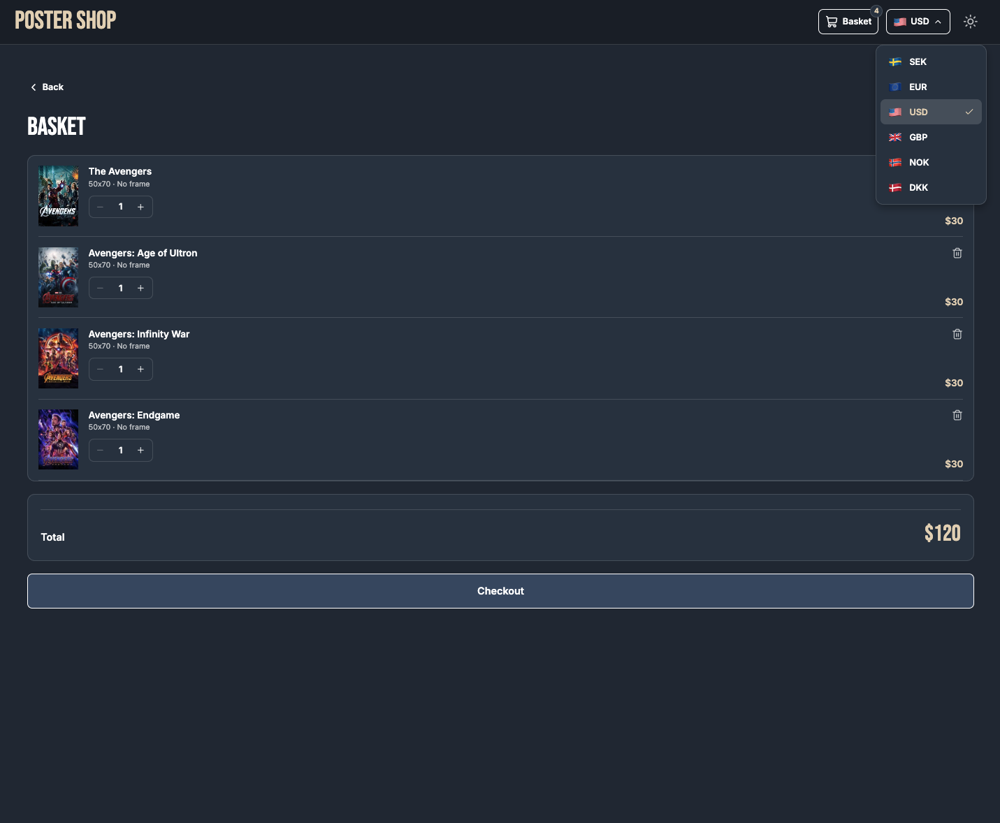

---

## Tech stack

|                  |                                                                |
| ---------------- | -------------------------------------------------------------- |
| Framework        | [Expo](https://expo.dev) (React Native) – iOS, Android and web |
| Language         | TypeScript (strict)                                            |
| Navigation       | Expo Router (file-based routing)                               |
| State management | Redux Toolkit + React Redux                                    |
| Movie data       | [TMDB API](https://www.themoviedb.org/documentation/api)       |
| Exchange rates   | [Frankfurter API](https://frankfurter.dev)                     |
| Icons            | lucide-react-native                                            |
| Fonts            | Bebas Neue, Inter (Expo Google Fonts)                          |
| Frame gradients  | expo-linear-gradient                                           |
| Toast animation  | react-native-reanimated                                        |

---

## Getting started

### Prerequisites

- [Node.js](https://nodejs.org) (LTS)
- [Expo Go](https://expo.dev/go) on your phone, or an iOS simulator / Android emulator
- A free **TMDB API key** – create an account at [themoviedb.org](https://www.themoviedb.org) and go to _Settings → API_

### Installation

```bash
git clone https://github.com/pjstrid/poster-shop.git
cd poster-shop
npm install
```

### Environment variables

Copy the example file and add your TMDB API key:

```bash
cp .env.example .env
```

```
EXPO_PUBLIC_TMDB_KEY=your_tmdb_api_key_here
```

> Use the short **API Key** (v3), not the long Read Access Token. The Frankfurter currency API does not need a key.

### Run the app

```bash
npx expo start
```

Then press:

- `i` – iOS simulator
- `a` – Android emulator
- `w` – web browser
- or scan the QR code with Expo Go

> After changing `.env`, restart with `npx expo start -c` to clear the cache.

---

## Project structure

```
src/
├── api/
│   ├── tmdb.ts            # TMDB client: typed request<T>(), lists, search, details, genres
│   └── currency.ts        # Frankfurter client: exchange rates
├── app/                   # Screens (Expo Router – each file is a route)
│   ├── _layout.tsx        # Fonts, Redux Provider, header, toast, fetches exchange rates
│   ├── index.tsx          # Shop: grid, search, chips
│   ├── movie/[id].tsx     # Movie details: poster, options, price, add to basket
│   └── basket.tsx         # Basket: rows, quantity, remove, clear, total
├── components/            # Header, ShopHeader, PosterCard, Chip, CartRow, Stepper,
│                          # CurrencyPicker, BackBtn, Footer, Toast
├── hooks/
│   ├── useDebounce.ts     # Delays a value until it stops changing (search)
│   ├── useFormatPrice.ts  # Formats a SEK price in the selected currency
│   ├── useIsDesktop.ts    # Breakpoint for mobile/desktop layout
│   └── useShopGrid.ts     # Columns, gaps and card width for the grid
├── store/
│   ├── index.ts           # Redux store, RootState, AppDispatch
│   ├── hooks.ts           # Typed useAppSelector / useAppDispatch
│   ├── settingsSlice.ts   # Theme, currency, exchange rates
│   ├── cartSlice.ts       # Basket items + selectors (count, total)
│   └── toastSlice.ts      # Toast message: showToast / hideToast
├── theme/                 # Colour tokens for dark/light theme, useTheme
├── types/                 # TMDB and shop types
└── utils/                 # Pricing, price formatting, fallback rates
```

---

## How it works (short version)

- **Data from TMDB** – all calls go through one typed `request<T>()` function that adds the API key and default parameters. The selected chip decides which endpoint is used (`getList`), and the search field switches to `/search/movie`.
- **Search** – the input updates instantly, but a `useDebounce` hook waits 400 ms after the last keystroke before a request is sent.
- **Loading state** – instead of a separate `loading` flag, the app compares _what is being asked for_ (list + search + reload counter) with _what was last loaded_. If they differ, it's loading. An `ignore` flag makes sure an old response never overwrites a newer one.
- **Redux** – the basket, settings (theme, currency, rates) and the toast message are shared across screens, so they live in the Redux store in three slices: `cartSlice`, `settingsSlice` and `toastSlice`. Data that only one screen needs (the movie list, selected size and frame) uses local `useState`.
- **Toasts** – any screen can call `dispatch(showToast("..."))`. A single `<Toast />` component, mounted once in the root layout on top of all screens, reads the message from Redux, shows it and dispatches `hideToast()` after 2.5 s. Because it lives outside the screens, the checkout toast stays visible while the app navigates back to the shop. Each toast gets a new `id`, so the same message twice in a row restarts the timer.
- **Prices** – all prices are stored in **SEK**. They are converted to the selected currency only when shown, via `useFormatPrice()`, using the live rate if available and a fallback rate otherwise.

### Known limitations

- The basket and selected currency are kept in memory and reset when the app is reloaded
- Checkout clears the basket and shows a confirmation toast, but no order is saved and there is no order history

---

## Use of AI

AI was used as **support** in this project:

- **Design** – the visual design (colours, layout, components for mobile and desktop) was created with **Figma Make**, together with **Claude** as support for the design prompt and design decisions. The design was then rebuilt by hand in React Native.
- **Planning and debugging** – Claude was used for planning the project in phases and branches, and helping with debugging.

The files `AGENTS.md` and `CLAUDE.md` in the repository are instructions for AI coding tools (Expo's recommendations for working with the current SDK).

---

## Attribution

This product uses the [TMDB](https://www.themoviedb.org) API but is not endorsed or certified by TMDB.

Exchange rates are provided by [Frankfurter](https://frankfurter.dev), based on data from central banks.

---

## Author

**Jonathan Strid** – [github.com/pjstrid](https://github.com/pjstrid)
